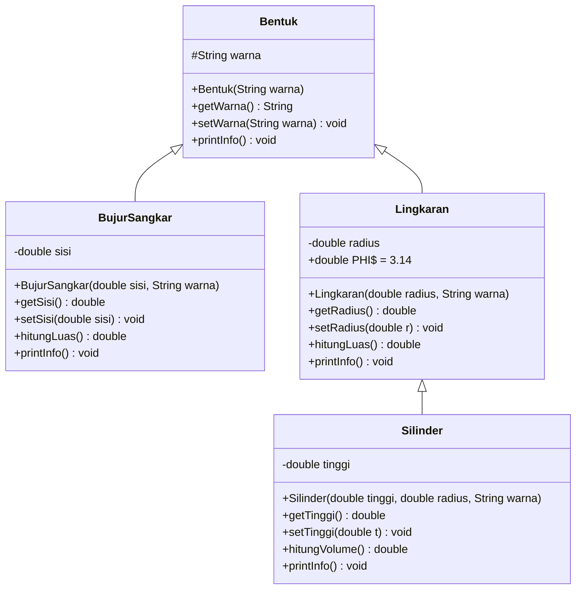
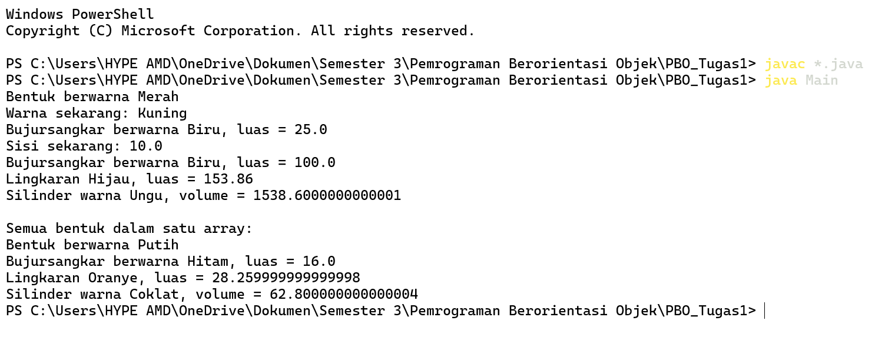

# 🔷 Inheritance dan Polimorfisme


Implementasi konsep **pewarisan (inheritance)** dan **polimorfisme** pada Java melalui hierarki bentuk geometri:
dari **Bentuk** umum hingga **Silinder** yang menghitung volume.

---

## 📑 Daftar Isi

- [Tentang Proyek](#-tentang-proyek)
- [Hierarki Kelas](#-hierarki-kelas)
- [Konsep yang Dipelajari](#-konsep-yang-dipelajari)
- [Struktur Proyek](#-struktur-proyek)
- [Penjelasan Kelas](#-penjelasan-kelas)
- [Cara Menjalankan](#-cara-menjalankan)
- [Contoh Output](#-contoh-output)
- [Polimorfisme dalam Proyek Ini](#-polimorfisme-dalam-proyek-ini)
- [Ide Pengembangan](#-ide-pengembangan)
- [Identitas Pembuat](#-identitas-pembuat)

---

## 📖 Tentang Proyek

Proyek ini dibuat untuk memahami bagaimana sebuah kelas dapat **mewarisi atribut dan method** dari kelas lain menggunakan kata kunci `extends`. Setiap kelas turunan menambahkan atribut dan perilaku miliknya sendiri, serta menyesuaikan method `printInfo()` melalui **method overriding**.

Rantai pewarisan yang digunakan:

> `Bentuk` → `Lingkaran` → `Silinder`
> `Bentuk` → `BujurSangkar`

## 🌳 Hierarki Kelas



## 🧠 Konsep yang Dipelajari

| Konsep | Penerapan dalam Proyek |
| --- | --- |
| **Inheritance (`extends`)** | `BujurSangkar` dan `Lingkaran` mewarisi `Bentuk`; `Silinder` mewarisi `Lingkaran` |
| **Multilevel Inheritance** | Tiga tingkat pewarisan: `Bentuk` → `Lingkaran` → `Silinder` |
| **`super()` Constructor** | Kelas turunan meneruskan `warna` / `radius` ke constructor induk |
| **Method Overriding** | `printInfo()` ditulis ulang di setiap kelas turunan |
| **Polimorfisme** | Satu array `Bentuk[]` menampung berbagai jenis bentuk, lalu `printInfo()` dipanggil dalam satu perulangan |
| **Encapsulation** | Atribut `private` / `protected`, diakses lewat *getter* dan *setter* |
| **Konstanta (`static final`)** | `PHI` pada `Lingkaran` sebagai nilai tetap |
| **Reuse Kode** | `Silinder` memakai `hitungLuas()` milik `Lingkaran` untuk menghitung volume |

## 📂 Struktur Proyek

```
📦 latihan-bentuk
 ┣ 📜 Bentuk.java          # Kelas induk (superclass)
 ┣ 📜 BujurSangkar.java    # Turunan Bentuk
 ┣ 📜 Lingkaran.java       # Turunan Bentuk
 ┣ 📜 Silinder.java        # Turunan Lingkaran
 ┣ 📜 Main.java            # Kelas utama (main)
 ┣ 🖼️ hasil.png            # Screenshot hasil program
 ┗ 📜 README.md
```

## 🔍 Penjelasan Kelas

### 🟣 `Bentuk` (Superclass)

Kelas dasar yang menyimpan atribut `warna`. Atribut ini `protected` supaya bisa dipakai oleh kelas turunan.

| Method | Deskripsi |
| --- | --- |
| `getWarna()` / `setWarna()` | Mengambil dan mengubah warna |
| `printInfo()` | Mencetak `Bentuk berwarna <warna>` |

### 🟦 `BujurSangkar` extends `Bentuk`

Menambahkan atribut `sisi`.

| Method | Deskripsi |
| --- | --- |
| `getSisi()` / `setSisi()` | Mengambil dan mengubah sisi |
| `hitungLuas()` | Menghitung luas: `sisi × sisi` |
| `printInfo()` | *Override*: mencetak warna dan luas |

### 🟠 `Lingkaran` extends `Bentuk`

Menambahkan atribut `radius` dan konstanta `PHI = 3.14`.

| Method | Deskripsi |
| --- | --- |
| `getRadius()` / `setRadius()` | Mengambil dan mengubah radius |
| `hitungLuas()` | Menghitung luas: `PHI × radius × radius` |
| `printInfo()` | *Override*: mencetak warna dan luas |

### 🟢 `Silinder` extends `Lingkaran`

Menambahkan atribut `tinggi`. Alas silinder adalah lingkaran, sehingga luas alas diambil dari method milik induk.

| Method | Deskripsi |
| --- | --- |
| `getTinggi()` / `setTinggi()` | Mengambil dan mengubah tinggi |
| `hitungVolume()` | Menghitung volume: `hitungLuas() × tinggi` |
| `printInfo()` | *Override*: mencetak warna dan volume |

### ▶️ `Main`

Membuat objek dari tiap kelas, mencoba getter dan setter, lalu menampilkan semua bentuk sekaligus lewat satu array `Bentuk[]`.

## 🚀 Cara Menjalankan

### Prasyarat

- **JDK 8** atau lebih baru ([Download JDK](https://adoptium.net/))

```
java -version
javac -version
```

### Langkah-langkah

**1. Clone repositori**

```
git clone https://github.com/<username>/<nama-repositori>.git
cd <nama-repositori>
```

**2. Kompilasi seluruh file**

```
javac *.java
```

**3. Jalankan program**

```
java Main
```

## 🖥️ Contoh Output

```
Bentuk berwarna Merah
Warna sekarang: Kuning
Bujursangkar berwarna Biru, luas = 25.0
Sisi sekarang: 10.0
Bujursangkar berwarna Biru, luas = 100.0
Lingkaran Hijau, luas = 153.86
Silinder warna Ungu, volume = 1538.6000000000001

Semua bentuk dalam satu array:
Bentuk berwarna Putih
Bujursangkar berwarna Hitam, luas = 16.0
Lingkaran Oranye, luas = 28.259999999999998
Silinder warna Coklat, volume = 62.800000000000004
```

### 📸 Screenshot Hasil



**Data uji dan perhitungannya:**

| Objek | Parameter | Rumus | Hasil |
| --- | --- | --- | --- |
| `BujurSangkar` | sisi = 5, warna = Biru | 5 × 5 | **25.0** |
| `Lingkaran` | radius = 7, warna = Hijau | 3.14 × 7 × 7 | **153.86** |
| `Silinder` | tinggi = 10, radius = 7, warna = Ungu | 153.86 × 10 | **≈ 1538.6** |

> 💡 **Catatan:** Angka seperti `1538.6000000000001` muncul karena bilangan desimal bertipe `double` tidak selalu presisi sempurna di komputer. Untuk tampilan lebih rapi, gunakan `System.out.printf("%.2f", nilai)`.

## 🎭 Polimorfisme dalam Proyek Ini

Karena `BujurSangkar`, `Lingkaran`, dan `Silinder` semuanya adalah turunan `Bentuk`, objek-objeknya bisa disimpan dalam satu array bertipe `Bentuk`:

```java
Bentuk[] semuaBentuk = new Bentuk[4];
semuaBentuk[0] = new Bentuk("Putih");
semuaBentuk[1] = new BujurSangkar(4, "Hitam");
semuaBentuk[2] = new Lingkaran(3, "Oranye");
semuaBentuk[3] = new Silinder(5, 2, "Coklat");

for (int i = 0; i < semuaBentuk.length; i++) {
    semuaBentuk[i].printInfo();   // yang jalan sesuai jenis objeknya
}
```

Perulangan di atas memanggil method yang **sama** (`printInfo()`), tetapi hasilnya **berbeda-beda** tergantung jenis objek aslinya. Inilah yang disebut **polimorfisme** (*runtime polymorphism*). Kalau nanti ada bentuk baru, perulangannya tidak perlu diubah sama sekali.

## 💡 Ide Pengembangan

- [ ] Menambahkan bentuk lain seperti `PersegiPanjang`, `Segitiga`, atau `Kerucut`
- [ ] Menambahkan method `hitungKeliling()` pada bentuk 2D
- [ ] Menggunakan `Math.PI` sebagai pengganti konstanta `PHI` manual
- [ ] Menjadikan `Bentuk` sebagai **abstract class**
- [ ] Memformat output menggunakan `printf` agar angka lebih rapi
- [ ] Menyimpan banyak bentuk dalam `ArrayList<Bentuk>`

---

## 🎓 Identitas Pembuat

| | |
| --- | --- |
| **Nama** | Rizky Fahrian Subban |
| **NIM** | F1D02510090 |
| **Kelas** | INFORMATIKA B |
| **Mata Kuliah** | Pemrograman Berorientasi Objek (PBO) |
| **GitHub** | https://github.com/RizkyFahrianSubban |

⭐ Jika proyek ini bermanfaat, jangan lupa beri bintang pada repositori ini! ⭐
